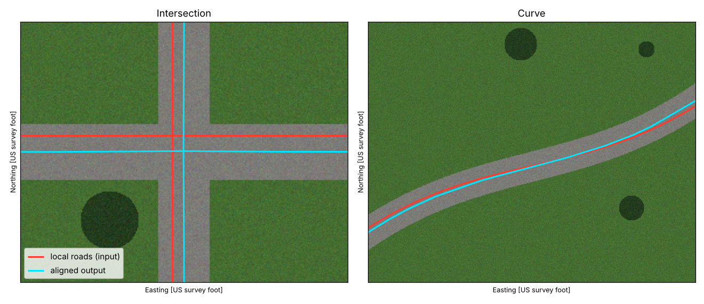

# Centerline Alignment

Moves road centerlines onto the middle of the pavement in your orthoimagery,
one 1-mile grid at a time, and writes a shapefile you can use to update your
deliverable road layer. Everything runs on your own machine; no data leaves it.



## How it works

1. **Learn what pavement looks like in *your* imagery.** The local road file
   doubles as training labels: pixels right on a road line count as "road",
   pixels 45–120 ft from any road count as "not road". A small classifier is
   trained on samples from a handful of grids and saved as
   `road_classifier.json`. It can use plain colour/texture features (no GPU),
   or add **foundation-model embeddings** (DINOv2 / DINOv3) on a GPU, which hold
   up better with shadows, mixed surfaces and gravel.
2. **Turn each grid into a road-probability map** (only near roads, to save time).
3. **Take cross-sections.** Every 10 ft along each road, the probability is
   sampled across the road, ±40 ft. The two pavement edges nearest the current
   line are found and their midpoint is the measured centre.
4. **Clean and rebuild.** Bad readings (trees, shadows, driveways) are dropped,
   gaps are filled from neighbouring stations, offsets are smoothed, and the
   line is rebuilt. Where the imagery gives no answer, the line stays put and
   is **flagged**, never guessed.
5. **Keep the network connected.** Intersections and grid-edge cuts are put
   back together at the point where the corrected roads cross.
6. **Write outputs** with QA fields for every line.

Grids are saved as they finish, so a county run can be stopped and restarted
(`run` skips finished grids).

## Option A: ArcGIS Pro toolbox (no installs)

Everything needed ships with ArcGIS Pro, so this works on a locked-down
machine with any licence level (Basic is fine).

1. **Get the file.** Open
   [`arcgis/CenterlineAlign.pyt`](arcgis/CenterlineAlign.pyt) on GitHub and use
   *Download raw file*. If downloads are blocked, click **Raw**, select all
   (Ctrl+A), copy, paste into Notepad, and save as `CenterlineAlign.pyt`
   (*Save as type: All files*, encoding UTF-8).
2. **Add it to Pro.** Catalog pane → Toolboxes → right-click → *Add Toolbox* →
   pick the file. Open **Align Centerlines to Imagery**.
3. **Fill in the tool:**
   * *Imagery*: the folder of `.tif` tiles (or a raster / mosaic dataset)
   * *Local road centerlines* + *Road ID field*
   * *Work grids* + *Grid ID field*
   * *Work folder*: any empty folder; progress and the trained classifier go here
   * *Output*: a shapefile or geodatabase feature class
   * *Bands*: defaults are R=1, G=2, B=3, NIR=4; clear NIR for 3-band imagery
   Step-by-step setup (folders, copying the imagery for your grids out of the
   state set): [docs/county_setup.md](docs/county_setup.md).
4. **Start small.** Select 2–3 grids in the map first; the tool only processes
   selected grids (and selected roads, if any are selected). Clear the selection for the full run.

Re-running with the same work folder skips grids that are already done. Tick
*Start over* (Advanced) after changing settings. The messages window shows
the imagery's units; all distance settings use them.

The toolbox uses the colour/texture classifier. GPU embeddings need PyTorch,
which is an install, so they're only in Option B.

## Option B: command line (needs a Python environment)

ArcGIS Pro's built-in Python lacks rasterio/geopandas, so this needs a
separate environment (ask IT if installs are restricted). With
[Miniforge](https://github.com/conda-forge/miniforge), in the Miniforge Prompt:

```bat
conda create -n centerline -c conda-forge python=3.11 geopandas rasterio scikit-learn scipy pyyaml pytest
conda activate centerline
cd path\to\CenterlineAutamation
python -m pytest tests          # should all pass
```

For GPU embeddings, also install PyTorch for your CUDA version
([pytorch.org](https://pytorch.org/get-started/locally/)) and `pip install transformers`.

## Your imagery

* **GeoTIFF tiles (`.tif` + `.tif.aux.xml`)**: point the tool at the folder.
  Tiles are read as one image (the command line builds
  `output/imagery_mosaic.vrt`; the toolbox reads tiles directly). Keep each
  `.aux.xml` next to its `.tif`; it can hold the projection and NoData value.
* **MrSID (`.sid`)**: not readable by the standard GDAL build. Use the
  GeoTIFF copies if they cover the same area, or convert in ArcGIS Pro with
  **Copy Raster** (output `.tif`) and point the tool at the result.
* **4-band (with near-infrared)?** Set `bands.nir: 4`. Separating vegetation
  from pavement is much easier with it. `check` prints sample band values and
  a reminder to confirm band 4 in a 4-1-2 false-colour view.
* **Pyramids** (`.ovr` / `.rrd` next to the tiles): keep them; they speed up
  the coarse reads used during training.
* **No NoData value set:** fine. Gaps between tiles are treated as no data;
  real pixels of exactly 0 in band 1 would be too, but 8-bit orthos rarely
  have them.

### How long it takes

On a full-size test (0.5 ft, 4-band, 10,000 × 10,000 px tiles, a city-style
street grid) one 1-mile grid took about **1 minute on CPU** in pixel mode, plus
about 1 minute per training grid once at the start. A county of a few hundred
grids is an overnight run; dense urban grids take longer than rural ones.
`resolution: 1.0` roughly quarters the time if you can accept a coarser
measurement.

## Running (command line)

```bat
copy config.example.yaml config.yaml      &:: then edit the paths and fields
python -m centerline_align check config.yaml          &:: checks files, CRS, bands, overlap
python -m centerline_align run config.yaml --grids G101 G102   &:: try a couple of grids first
python -m centerline_align run config.yaml            &:: the whole county
```

`--fresh` throws away finished grids and the saved classifier and starts over
(do this after changing classifier or refine settings).

No data handy? `python scripts/make_demo_data.py` writes a synthetic scene and
config to `demo/`.

## Outputs

The toolbox writes the output feature class you choose (same fields as below)
and keeps per-grid progress in the work folder. The command line writes to
`output/`:

| File | What it is |
|---|---|
| `aligned_centerlines.shp` / `.gpkg` | the aligned lines, split at grid edges |
| `grid_summary.csv` | per grid: pieces, length, number and length flagged, average shift, time |
| `grids/<id>.gpkg` | per-grid results (and `stations` points if `write_stations: true`) |
| `grids/<id>_prob.tif` | road-probability map if `write_probability: true` |
| `road_classifier.json` | the trained classifier (reused on later runs) |

Fields on each line:

| Field | Meaning |
|---|---|
| `SRC_ID` | id of the input road (`road_id_field`) |
| `GRID_ID` | grid it was processed in |
| `SHIFT_AVG`, `SHIFT_MAX` | how far the line moved (CRS units) |
| `CONF` | 0–1 confidence: pavement contrast × share of usable cross-sections |
| `PCT_VALID` | share of cross-sections that found pavement |
| `WIDTH_MED` | median measured pavement width; a sanity check |
| `REVIEW` | 1 = check this one by eye |
| `REASON` | why: `low_confidence`, `few_matches`, `large_shift`, `no_imagery` |

**Review workflow:** symbolise on `REVIEW`, fix or accept the flagged lines,
spot-check a sample of the unflagged ones, and keep track of how often you
had to edit, since that tells you whether to tighten or loosen the thresholds.

## Getting the geometry into the deliverable layer

The output is split at grid edges. In ArcGIS Pro, first run **Dissolve** on
`SRC_ID` (uncheck *multipart*, check *unsplit lines*) to get one line per road.

* **Deliverable layer shares the local road IDs:** join on the ID and copy
  the shapes over, e.g. in the Pro Python window (untested sketch; try it on a
  copy first):

  ```python
  import arcpy
  new = {r[0]: r[1] for r in arcpy.da.SearchCursor("aligned_dissolved", ["SRC_ID", "SHAPE@"])}
  with arcpy.da.UpdateCursor("Deliverable_Roads", ["OBJECTID", "SHAPE@"]) as cur:
      for oid, shp in cur:
          if oid in new:
              cur.updateRow([oid, new[oid]])
  ```
* **Deliverable is the state layer (different IDs/segmentation):** use the
  aligned output as the target in **Generate Rubbersheet Links** /
  **Rubbersheet Features**, or match segments first with **Transfer Attributes**.
  If the state layer carries LRS measures, recalibrate routes afterwards.

## Tuning

| Symptom | Try |
|---|---|
| Lines pulled toward parking lots / wide shoulders | lower `max_road_width`, raise `prob_threshold` |
| Lots of `few_matches` under trees | expected; review them. Embeddings or NIR help |
| Local file is very far off in places | raise `search_half_width` and `max_shift` |
| Too slow | set `resolution: 1.0` (or 0.5), process grids in batches |
| Jagged output | raise `smooth_window` or `simplify_tolerance` |

Turn on `write_stations` and `write_probability` for a few grids to see
exactly what each cross-section measured.

## Limits

* It refines **existing** lines; it does not invent roads missing from the
  local file.
* Measurements at intersections are noisy; ends are fixed by the network
  step, but give intersections a look.
* Tested here on synthetic imagery only (lines started about 5.6 ft off and
  ended about 0.1 ft off). Real orthos are harder: expect to tune on a few
  grids before a county run.
* Embedding mode was tested for plumbing with a tiny random model; the real
  DINOv2/DINOv3 weights download from Hugging Face on first use (DINOv3 is
  gated: accept its licence there first).
* The ArcGIS toolbox is tested here against a stand-in for `arcpy`
  (`tests/fake_arcpy.py`) that follows the documented arcpy behaviour. It
  hasn't run inside real ArcGIS Pro yet; if a message in the geoprocessing
  window looks wrong, copy it into an issue.

## Development

`arcgis/CenterlineAlign.pyt` is generated from the `centerline_align` package.
After changing the package, rebuild it with `python scripts/build_pyt.py`; a
test fails if the committed `.pyt` is out of date.
